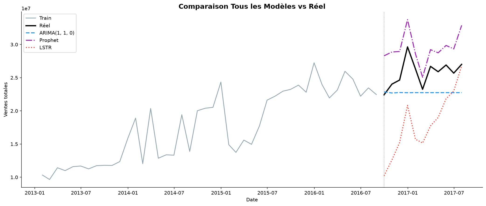

# Monthly Sales Forecasting: ARIMA vs Prophet vs LSTR

Comparison of three time-series models for forecasting monthly retail sales, built on the Kaggle *Store Sales - Time Series Forecasting* dataset (Corporación Favorita, Ecuador).

## Data

- Source: [Kaggle - Store Sales - Time Series Forecasting](https://www.kaggle.com/competitions/store-sales-time-series-forecasting)
- About 2.97 million daily records, 54 stores, 33 product families, January 2013 to July 2017
- Extra files used: oil prices, holidays, and store transactions
- The data is **not included** in this repository. Download it from Kaggle (see "How to run")

## Method

1. **Exploration:** sales distribution, zero-sales families, seasonality, and the link between sales and oil price, promotions and transactions
2. **Preparation:** daily sales aggregated to a monthly series (55 months), with oil price, transactions and holiday counts added as external variables
3. **Stationarity:** ADF and KPSS tests show the series is not stationary, so one differencing step (d=1) is used
4. **Split:** time-based, with no shuffling. 44 months for training (2013-01 to 2016-08) and 11 months for validation (2016-09 to 2017-07)
5. **Models:**
   - **ARIMA:** order chosen by grid search on AIC, which selected ARIMA(1,1,0)
   - **Prophet (Meta):** multiplicative yearly seasonality, with oil price and transactions as extra regressors
   - **LSTR (Logistic Smooth Transition Regression):** implemented from scratch with SciPy. It switches smoothly between two linear regimes through a logistic function

## Results (validation set, 11 months)

| Model | MAE | RMSE | MAPE | R² |
|---|---|---|---|---|
| **ARIMA(1,1,0)** | **3,014,167** | **3,519,372** | **11.28%** | -2.34 |
| Prophet | 3,732,174 | 3,962,815 | 14.68% | -3.23 |
| LSTR | 7,675,187 | 8,447,210 | 30.50% | -18.22 |



## What I learned

- **ARIMA performs best on all error metrics.** Prophet and LSTR were given the actual oil price and transaction counts for the validation months, which would not be known in a real forecast, and they still did not beat ARIMA.
- **A data issue changed the ranking.** The dataset ends on 15 August 2017, so August 2017 is only a half month. With it included, Prophet ranked first (RMSE 4.38M vs 4.50M for ARIMA). After removing the incomplete month, ARIMA is clearly ahead.
- **R² is negative for all models**, meaning none of them beats simply predicting the average of the validation period. With only 11 validation months, R² is very sensitive, so MAE and MAPE are the more reliable metrics here.
- **Interpret the ARIMA result with care.** ARIMA(1,1,0) produces an almost flat forecast, so it wins partly because sales were fairly stable during the validation window. This does not show it is better in general.

## Limitations and next steps

- Only 55 months of data and a single train/validation split. A rolling-origin cross-validation would give more reliable comparisons
- Seasonal ARIMA (SARIMA), gradient boosting (XGBoost), and models per store or product family
- For a real forecast, the oil price and transactions would also need to be forecasted

## How to run

```bash
git clone https://github.com/ouiambouali/sales-forecasting-arima-prophet-lstr.git
cd <your-repo>
python -m venv .venv
.venv\Scripts\activate        # Windows
pip install -r requirements.txt
```

1. Download the dataset from the Kaggle link above
2. Put `train.csv`, `test.csv`, `stores.csv`, `oil.csv`, `holidays_events.csv` and `transactions.csv` in a `data/` folder
3. Open `forecasting.ipynb` and run all cells

## Tech stack

Python, pandas, NumPy, statsmodels, Prophet, SciPy, scikit-learn, Matplotlib, Seaborn, Jupyter
